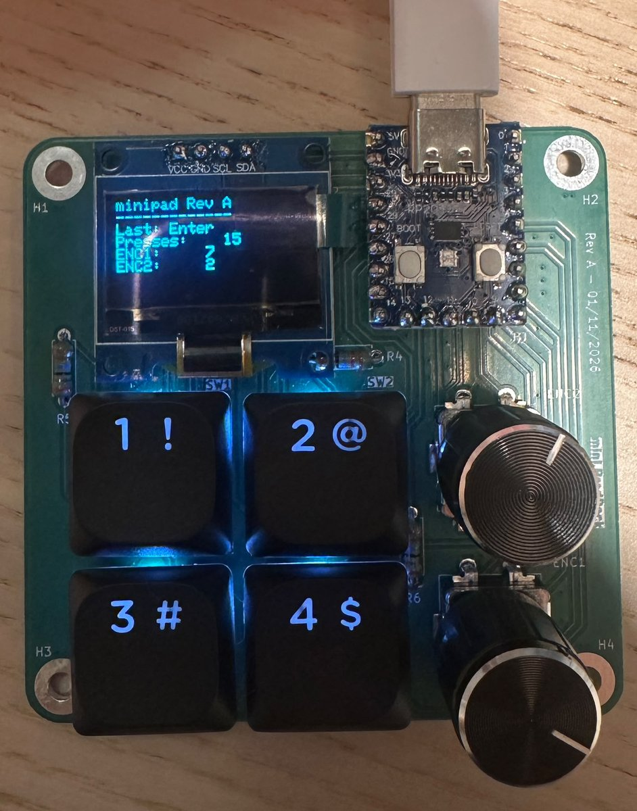
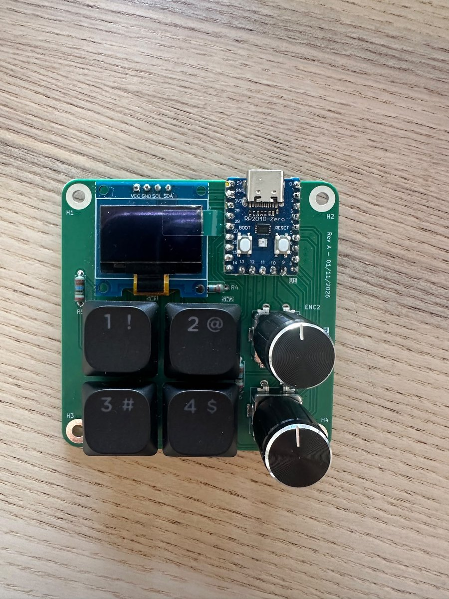
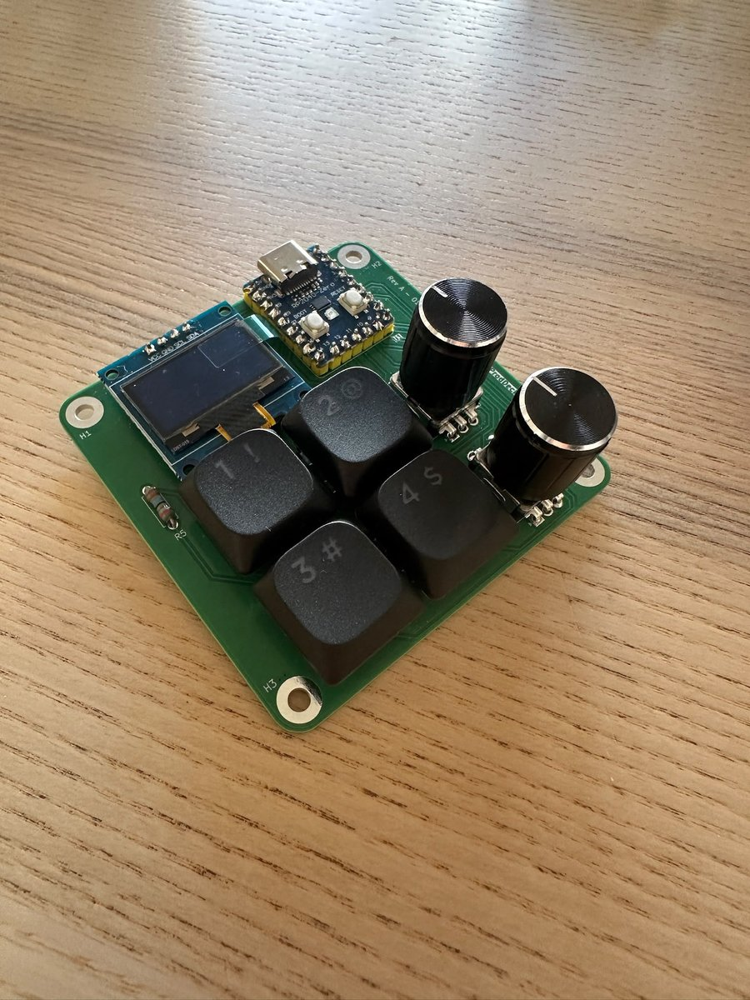

# Minipad

A small USB macropad: 4 low-profile keys with white backlight LEDs, 2 rotary encoders with push buttons and a
0.96" OLED, on a custom 2-layer PCB, running QMK.

It's my first PCB, built as a learning project that covers the whole path from a blank page to a working
board: requirements, part selection, schematic and layout in KiCad 10, ordering from a fab, hand assembly,
bring-up and firmware. The goal was to understand each step well enough to design the next board alone.

<p align="center">
  
</p>

<p align="center">
  
  
</p>

## Status
**Rev A is fully assembled and every input and output works.**

| | |
|---|---|
| Rev A ordered | 2026-11-03, PCBWay |
| Arrived, assembled | 2026-11-13; 2026-11-14 (all but the encoders), encoders 2026-11-19 |
| Tested on the board | 2026-11-14: all 4 keys type; all 4 key LEDs breathe (hardware PWM); OLED shows a status screen. 2026-11-19: both encoders turn and push (volume/mute, arrows/Enter), counted on the OLED |
| Next | VIA remapping, the case, and a Rev B with the lessons from Rev A |

Day-to-day state, open questions and next actions: [STATUS.md](STATUS.md).

## Hardware
| Part | Choice | Why (ADR) |
|---|---|---|
| MCU | RP2040-Zero (clone), soldered on as a module | [0001](docs/decisions/0001-mcu-rp2040-zero-module.md) |
| Switches | Gateron KS-33 Low Profile 2.0, soldered | [0002](docs/decisions/0002-switches-gateron-ks33-low-profile.md) |
| Key LEDs | White 1206 LEDs under the switches, hand-soldered | [0009](docs/decisions/0009-fab-tht-plus-hand-soldered-1206-leds.md) |
| Encoders | Bourns PEC11L-4115F-S0020, with push switch | [0013](docs/decisions/0013-encoders-bourns-pec11l-4115f.md) |
| Display | 0.96" 128 × 64 SSD1306, I2C | [0004](docs/decisions/0004-oled-ssd1306-i2c.md) |
| Wiring | One GPIO per input, no matrix | [0006](docs/decisions/0006-direct-pin-wiring.md) |
| PCB | 2 layers, 69.8 × 69.1 mm, through-hole except the LEDs, PCBWay | [0012](docs/decisions/0012-fab-pcbway-instead-of-jlcpcb.md) |
| Mounting | Four M3 holes, one per corner | [0010](docs/decisions/0010-m3-mounting-holes-at-the-corners.md) |
| Firmware | QMK, with VIA for remapping, own PC app later | [0005](docs/decisions/0005-firmware-qmk.md), [0008](docs/decisions/0008-remapping-via-then-own-app.md) |

Parts list with sources and verification: [docs/hardware/parts.md](docs/hardware/parts.md).
GPIO allocation: [docs/hardware/pinout.md](docs/hardware/pinout.md).

## How the project is run
The work follows 13 steps in 4 phases ([docs/phases/](docs/phases/)). Each step has an exit criterion that
has to be met before the next one starts.

- **Decisions** are written down as ADRs ([docs/decisions/](docs/decisions/)): the context, the real
  alternatives, what was chosen and what was rejected. When I changed my mind, I wrote a new ADR instead of
  editing the old one, for example when the encoders changed from generic EC11s to Bourns (0003 → 0013) and
  the fab from JLCPCB to PCBWay (0012, superseding 0009).
- **Every dimension cites a source:** a datasheet page or a measurement on the real part. Otherwise it says
  `TBD`. The parts are clones and generics, so the original datasheets are a starting point, not proof.
- **A log per working day** ([docs/log/](docs/log/)), append-only: mistakes are corrected in a later entry,
  not erased.
- Rev A was ordered **before** every footprint was verified against the real parts, as a deliberate
  trade-off ([ADR-0011](docs/decisions/0011-order-rev-a-before-parts-verification.md)).

## How I used AI
I used [Claude Code](https://claude.com/claude-code) as a mentor throughout, and the setup is part of this
repository: the commands and rules in [`.claude/`](.claude/) and the logs show what it did and what I did.

- **What I did:** made or approved every decision (the ADRs record the alternatives, the reasons, and who proposed what); drew the schematic;
  placed and routed the PCB; ordered the boards; assembled and soldered Rev A; flashed it and tested every
  fitted part.
- **What Claude did:** explained each step before I did it; reviewed my schematic and layout; read datasheets
  and part listings with me and checked them against the requirements; drafted most of the documentation
  (ADRs, logs and this README); and wrote parts of the firmware, which I tested on the board.
- **The rules it worked under:** no dimension, pinout or limit from memory (cite a source or write `TBD`);
  hardware results are recorded only as reported by me, with the date; it never places orders, and
  commits or pushes only when I ask.

Commands used in sessions:

| Command | When |
|---|---|
| `/where-are-we` | Start of a session: recap and next step |
| `/check-part <part>` | Evaluating a listing, or when a part arrives |
| `/decision <title>` | After choosing between real alternatives (writes an ADR) |
| `/gate` | When a step's exit criterion looks met |
| `/pre-order` | Before ordering the PCB |
| `/log-session` | End of a session: log entry and STATUS update |

## Building it yourself
**Hardware:** open [`hardware/kicad/mini-pdeck.kicad_pro`](hardware/kicad/) in KiCad 10. The libraries are
project-local, so nothing needs installing. Checks:
```sh
kicad-cli sch erc -o hardware/kicad/production/erc.rpt hardware/kicad/mini-pdeck.kicad_sch
kicad-cli pcb drc -o hardware/kicad/production/drc.rpt hardware/kicad/mini-pdeck.kicad_pcb
```
Rev A has known issues and unverified footprints (see [STATUS.md](STATUS.md) and
[docs/hardware/parts.md](docs/hardware/parts.md)). Check them before ordering a copy.

**Firmware:** set up QMK and link the keyboard folder as described in
[firmware/README.md](firmware/README.md), then build:
```sh
qmk compile -kb minipad -km default
```
(On this project's Windows PC, QMK runs in WSL: `wsl bash firmware/build.sh` builds and copies the `.uf2`
to `firmware/out/`.)
Flash: hold BOOT on the RP2040-Zero, plug it in, and copy the `.uf2` onto the `RPI-RP2` drive.

## Repository layout
```
.
├── README.md, STATUS.md      # Overview; current state and open questions
├── LICENSE.md, LICENSES/     # Which licence covers what, and the full texts
├── .claude/                  # Claude Code setup: permissions, rules, commands, review agent
├── docs/
│   ├── phases/               # The 13 steps in 4 phases, with exit criteria
│   ├── decisions/            # ADRs: what was chosen, what was rejected and why
│   ├── log/                  # One file per working day, append-only
│   └── hardware/             # Parts, pinout, mechanical, fabrication, bring-up, datasheet links
├── hardware/kicad/           # KiCad 10 project and project-local libraries
├── firmware/
│   ├── qmk/minipad/          # QMK keyboard definition and keymap
│   ├── bench/                # Arduino sketches used to test the OLED and an encoder before the PCB
│   └── build.sh              # Build in WSL and copy the .uf2 to firmware/out/
└── case/                     # Enclosure (not started)
```

## Licence
Hardware: [CERN-OHL-P-2.0](LICENSES/CERN-OHL-P-2.0.txt). Firmware: [GPL-2.0-or-later](LICENSES/GPL-2.0-or-later.txt).
Documentation: [CC-BY-4.0](LICENSES/CC-BY-4.0.txt). Some library files come from other projects and keep their
own licence. Details: [LICENSE.md](LICENSE.md).
